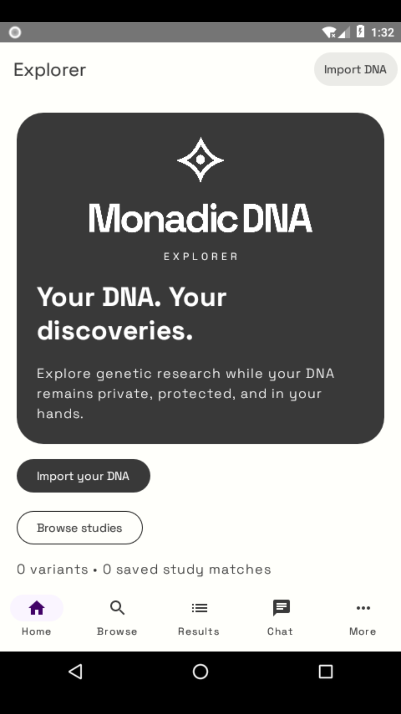
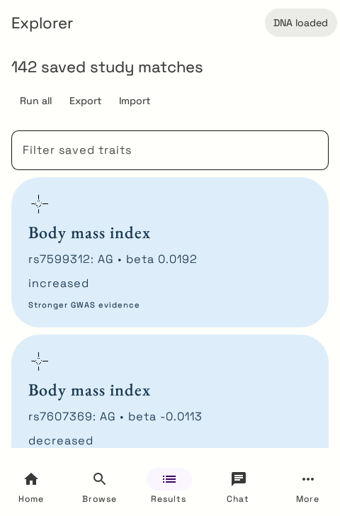
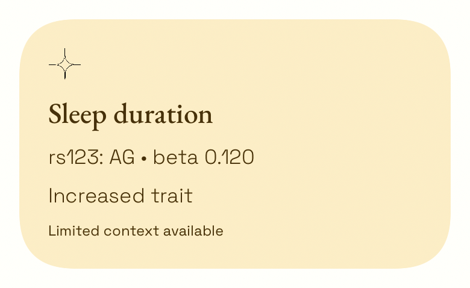

# Native visual alignment with Vault

Explorer's Android (Compose) and iOS (SwiftUI) apps share the visual language of [Monadic DNA Vault](https://github.com/Monadic-DNA/Vault/tree/58c9f56f8be5b091dddd002d0e422d2a96f3a931). They retain their own native layouts and Explorer functionality.

| Element | Vault reference | Explorer implementation |
| --- | --- | --- |
| Brand | Header mark, white wordmark, charcoal background | Branded home panel and original app icon |
| Typography | Space Grotesk Light/Bold, EB Garamond Medium | Body, navigation, headings and serif result titles |
| Surfaces | Off-tone canvas, charcoal buttons, pastel trait cards | Native theme, capsule actions, 40-point result cards |
| Illustrations | Vault, DiscoverCards, geometric star | Vault/reports screens and result accents |
| Colors | Original sRGB / Display P3 assets | Generated Compose colors and SwiftUI asset catalog |

Canonical artwork, font licenses, source paths/checksums, and the regeneration instructions live in [design/vault](../design/vault/README.md). App builds use checked-in resources and do not need the Vault checkout.

## Validation

Android debug assembly, Kotlin/JNI unit tests and lint passed. Both API 26 emulator tests passed after restyling, including import of the full public 23andMe sample and checking all 142 expected result scores. Home and populated results screenshots were visually inspected:

| Home | Results with public sample |
| --- | --- |
|  |  |

The iOS simulator build and all five XCTest tests passed in [CI run 39608592827](https://github.com/Monadic-DNA/Explorer/actions/runs/39608592827). The native result-card rendering was also inspected:

The iOS `VaultDesignTests` verify that the actual app bundle contains all four fonts and five illustrations, and render the home panel and a result card with SwiftUI. CI exports the retained XCTest image attachments as `explorer-ios-visual-snapshots`, alongside the complete `explorer-ios-test-results` bundle. The iOS job also runs the existing native binding and public DNA sample tests.
